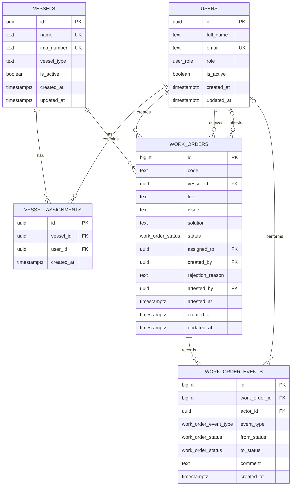

# FleetOps

FleetOps is a small marine work order dashboard built with Next.js, TypeScript, and Supabase. It keeps work orders tied to a vessel and gives admins, captains, and crew members different views and actions.

- Live app: [marine-work-order-ms.vercel.app](https://marine-work-order-ms.vercel.app/)
- Repository: [github.com/sasori13L/Technical-Assignment](https://github.com/sasori13L/Technical-Assignment)
- Database schema: [`supabase/schema.sql`](supabase/schema.sql)
- Demo data: [`supabase/seed.sql`](supabase/seed.sql)
- Deployment guide: [`DEPLOYMENT.md`](DEPLOYMENT.md)

## How the demo works

There is no email login. The sticky bar at the top acts as a mock session switcher:

1. Choose a vessel.
2. Choose a role: Admin, Captain, or Crew.
3. Choose an active member.

The available members and the rest of the dashboard update based on those selections. Admins can work across all vessels, while captains and crew only see vessels assigned to them.

Some useful demo accounts:

| Vessel | Role | Member | What to try |
| --- | --- | --- | --- |
| MV Pacific Dawn | Captain | Rafael Mendoza | Create a work order, assign crew, then attest or reject completed work. |
| MV Pacific Dawn | Crew | Liza Tan | Start assigned work, add a solution, and submit it as Done. |
| MV Pacific Dawn | Crew | Noel Bautista | View open, submitted, and attested work orders. |
| Any vessel | Admin | Daniel Okoye | Manage users, vessels, roles, and vessel assignments. |

## Main features

### Admin

- Create, view, update, and deactivate users and vessels.
- Assign roles and add, update, or remove vessel assignments.
- Keep deactivated records instead of deleting their history.
- Prevent duplicate emails, vessel names, and IMO numbers.
- Block changes that would leave active work without an assigned crew member or captain.
- View work orders for one vessel or all vessels.

### Captain

- View work orders for assigned vessels.
- Create a work order and assign it to active crew on the same vessel.
- Review work marked Done.
- Attest completed work or reject it with a required reason.

### Crew

- View only assigned work orders.
- Move an order from Open to In Progress.
- Record the solution and mark the order Done.
- See a captain's rejection reason and resubmit the work.

## Work order lifecycle

The database uses only the three statuses required by the brief: `Open`, `In Progress`, and `Done`.

```text
Open -> In Progress -> Done -> Attested and locked
           ^             |
           +-- Rejected -+
```

Attested is not a separate status. It is recorded with `attested_at` and `attested_by`. When a captain rejects an order, it returns to `In Progress` and the reason is saved in the work order history.

Every work order includes:

- Work order ID
- Title
- Issue
- Solution, required before marking the order Done
- Status
- Vessel, creator, and assigned crew member

## Entity relationship diagram



The complete table definitions, constraints, indexes, triggers, grants, and RLS policies are in [`supabase/schema.sql`](supabase/schema.sql).

## Security and data rules

Most data fetching and updates happen in the browser through the Supabase client. The only server route is `/api/session`, which creates a short-lived JWT for the selected demo user.

Supabase Row Level Security uses that token to enforce access:

| Role | Access |
| --- | --- |
| Admin | Manage users, vessels, roles, and assignments. Work orders are read-only. |
| Captain | Read and manage work orders for assigned vessels. |
| Crew | Read and update only work orders assigned to them. |

Database constraints and triggers also enforce the status flow, required solutions and rejection reasons, valid vessel assignments, duplicate prevention, and deactivation rules. The `work_order_events` table keeps an append-only history of work order changes.

Because this project intentionally uses mock authentication, anyone who can use the member switcher can act as an active demo user. A production version should replace this with Supabase Auth. The Supabase anon key cannot read the main tables on its own; it can only call the limited functions needed to fill the switcher.

Lists are paginated and cached, and the main database access paths are indexed. The interface uses tables on larger screens and cards on smaller screens so the same workflows remain usable on desktop, tablet, and mobile.

## Tech stack

- Next.js 16 with the App Router
- TypeScript
- Supabase Postgres and Row Level Security
- TanStack Query
- Tailwind CSS
- Zod
- `jose` for demo session tokens

## Run locally

Requirements:

- Node.js 20.9 or newer
- A Supabase project

### 1. Set up the database

Run these files in the Supabase SQL editor, in order:

1. `supabase/schema.sql`
2. `supabase/seed.sql`

The scripts are intended for a fresh project.

### 2. Add environment variables

Copy `.env.example` to `.env.local` and add:

```bash
NEXT_PUBLIC_SUPABASE_URL=https://YOUR-PROJECT-REF.supabase.co
NEXT_PUBLIC_SUPABASE_ANON_KEY=YOUR-ANON-KEY
SUPABASE_JWT_SECRET=YOUR-LEGACY-JWT-SECRET
```

`SUPABASE_JWT_SECRET` is server-only and must not use the `NEXT_PUBLIC_` prefix. This demo signs HS256 tokens, so the Supabase project's legacy JWT secret must be enabled.

### 3. Install and start

```bash
npm install
npm run dev
```

Open [http://localhost:3000](http://localhost:3000).

## Available scripts

```bash
npm run dev        # local development
npm run lint       # ESLint
npm run typecheck  # TypeScript checks
npm test           # regression tests
npm run build      # production build
npm start          # run the production build
```

For a fuller manual checklist, see [`test-cases.md`](test-cases.md). The deployment smoke test is also available:

```bash
node scripts/verify-deployment.mjs \
  --app <app-url> \
  --supabase <project-url> \
  --anon <anon-key>
```

## Project structure

```text
src/
  app/            pages and the demo session route
  components/     dashboard, admin, session, and shared UI
  services/       Supabase queries and mutations
  lib/            types, validation, formatting, and auth helpers
supabase/
  schema.sql      tables, indexes, triggers, RLS, and grants
  seed.sql        demo users, vessels, assignments, and work orders
scripts/          deployment smoke test
tests/            application regression tests
```

## Deployment

The app is deployed on Vercel. To deploy another copy, import the repository and add the same three environment variables used locally. Keep `SUPABASE_JWT_SECRET` server-only. See [`DEPLOYMENT.md`](DEPLOYMENT.md) for the full setup and troubleshooting notes.
